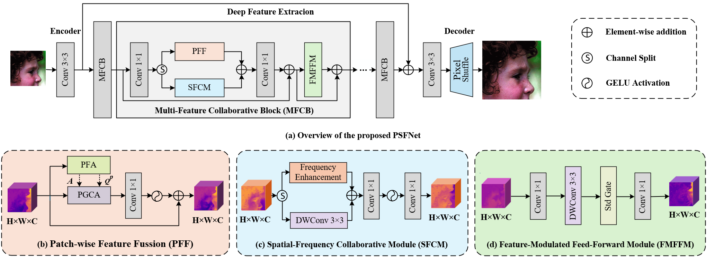
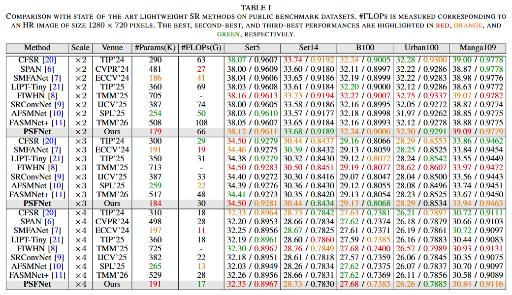
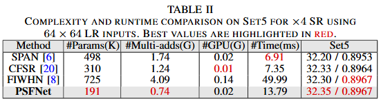
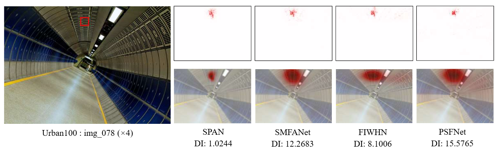
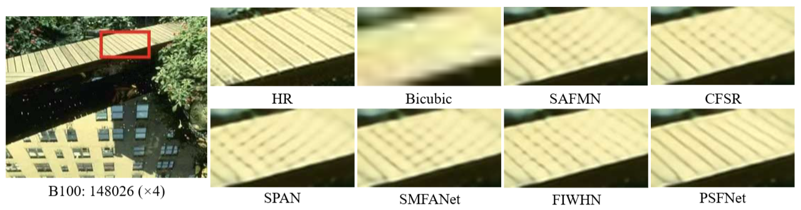

# PSFNet

PyTorch implementation of **PSFNet: Patch-wise and Spatial-Frequency Collaborative Network for Lightweight Image Super-Resolution**.

PSFNet is a lightweight single-image super-resolution network that jointly exploits structural relationships, spatial-frequency information, and feature statistics. Its main components include:

- **PFF (Patch-wise Feature Fusion)**, consisting of:
  - **PFA (Patch-wise Feature Aggregation)** for variance-guided structural prototype construction.
  - **PGCA (Prior-Guided Cross-Attention)** for affinity-guided non-local interaction.
- **SFCM (Spatial-Frequency Collaborative Module)** for lightweight spatial-frequency feature enhancement.
- **FMFFM (Feature-Modulated Feed-Forward Module)** with a parameter-free standard-deviation-based gate.

For ×4 super-resolution, PSFNet contains about **191K parameters** and achieves **32.35 dB on Set5** and **30.84 dB on Manga109**.

---

## Network Architecture



*Overall architecture of PSFNet. Each MFCB contains parallel PFF and SFCM branches, followed by FMFFM.*

---

## Requirements

- Python 3.8
- PyTorch >= 1.8
- BasicSR 1.4.2
- Ubuntu 18.04
- CUDA 11

---

## Installation

```bash
git clone https://github.com/isymwang/PSFNet.git
cd PSFNet

conda create -n psfnet python=3.8
conda activate psfnet

pip install -r requirements.txt
python setup.py develop
```

For additional environment setup details, please refer to the [BasicSR installation guide](https://github.com/XPixelGroup/BasicSR/blob/master/docs/INSTALL.md).

---

## Data Preparation

### Training Dataset

- DIV2K

### Testing Datasets

- Set5
- Set14
- B100
- Urban100
- Manga109

Please organize the datasets according to the paths specified in the YAML configuration files under `options/`.

---

## Training

The training settings used for PSFNet are:

- Number of MFCBs: 8
- Feature channels: 36
- LR patch size: 64 × 64
- Batch size: 64
- Data augmentation: random flips and rotations
- Loss: L1 loss
- Optimizer: Adam (`β1 = 0.9`, `β2 = 0.99`)
- Learning rate: cosine decay from `1e-3` to `1e-5`
- Training iterations: 1,000,000

Example for ×4 training:

```bash
python basicsr/train.py -opt options/train/PSFNet_DIV2K_100w_x4SR.yml
```

The ×2 and ×3 models can be trained using their corresponding configuration files.

---

## Testing

Example for ×4 evaluation:

```bash
python basicsr/test.py -opt options/test/PSFNet_DF2K_x4SR.yml
```

Peak signal-to-noise ratio (PSNR) and structural similarity index (SSIM) are calculated on the Y channel without self-ensemble.

---

## Pretrained Models

Pretrained models are available in:

```text
PSFNet/pretrain/
```

---

## Experimental Results

### Quantitative Comparison



*Quantitative comparison with representative lightweight SR methods on Set5, Set14, B100, Urban100, and Manga109.*

For ×4 SR, PSFNet achieves **32.35 / 0.8967** on Set5 and **30.84 / 0.9116** on Manga109 with only **191K parameters**.

### Complexity Analysis



*Complexity and runtime comparison on Set5 for ×4 SR using 64 × 64 LR inputs.*

For ×4 SR, PSFNet uses **191K parameters**, **0.74G Multi-Adds**, and reports **13.79 ms** runtime under the evaluation setting used in the manuscript.

### Visual Comparison



*Visual comparison on image 148026 from B100 for ×4 SR.*

### Local Attribution Map and Diffusion Index Comparison



*Local Attribution Map (LAM) and Diffusion Index (DI) comparison on img_078 from Urban100 for ×4 SR.*

---

## Citation

Citation information will be updated after publication.

---

## Acknowledgement

This project is built upon [BasicSR](https://github.com/XPixelGroup/BasicSR). We thank the authors for their excellent open-source framework.

---

## Contact

For questions about PSFNet, please contact:

- Zhongna Ying: `241607010091@hhu.edu.cn`
- Qian Huang: `huangqian@hhu.edu.cn`
